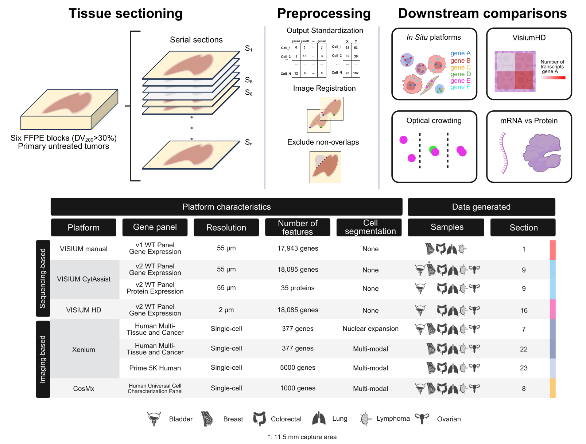

# Benchmarking Spatial Transcriptomics Technologies Across Six Cancer Types

> **Title**: Benchmarking of spatial transcriptomics platforms across six cancer types  
> **Authors**: Sergi Cervilla*, Daniela Grases*, Elena Perez, Francisco X. Real, Eva Musulen, Julieta Aprea, Manel Esteller, Eduard Porta-Pardo  
> **Preprint (April 2025)**: https://doi.org/10.1101/2024.05.21.593407

---

## Overview

This repository contains the analysis and figure scripts used in our benchmarking study, which compares multiple spatial transcriptomics platforms across six cancer types.

---

## Download the data
**Visium v1, Visium v2/CytAssist, VisiumHD**: https://doi.org/10.5281/zenodo.17999961
**Xenium (Multi-tissue without multi-modal segmentation), CosMx**: https://doi.org/10.5281/zenodo.17986017
**XeniumMT (Multi-tissue), Xenium5K (Prime 5K)**: https://doi.org/10.5281/zenodo.18000256
---

## Contact information
- **Data Analysis**: [Sergi Cervilla] – [scervillag@carrerasresearch.org]  
- **Wet Lab Experiments**: [Daniela Grases] – [dgrases@carrerasresearch.org]  
- **Corresponding Author**: [Eduard Porta] – [eporta@carrerasresearch.org]
---
